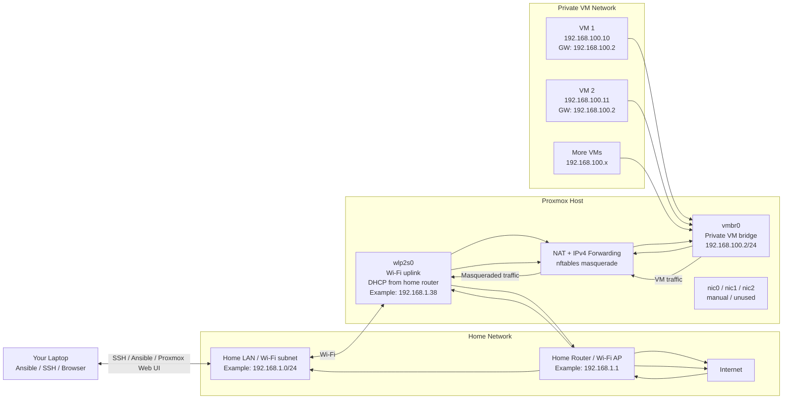
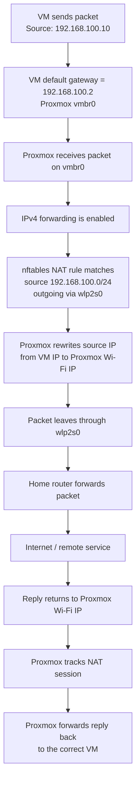

# Proxmox Wi-Fi NAT Network Architecture

This diagram shows your current **Proxmox over Wi-Fi + NAT for VMs** design.

- **Proxmox host** connects to your home network through **Wi-Fi** (`wlp2s0`) and gets its IP by DHCP.
- **VMs do not connect directly to Wi-Fi**.
- VMs connect to **`vmbr0`**, a **private internal bridge**.
- Proxmox acts as the **gateway/router** for the VMs.
- **NAT (masquerade)** on Proxmox translates VM traffic so it can reach your home router and the internet.

---

## Main Architecture Diagram



---

## What Happens Step by Step



---

## IP Layout Summary

```text
Home router / Wi-Fi network:
  192.168.1.0/24

Proxmox Wi-Fi interface:
  wlp2s0 -> DHCP from router
  Example IP: 192.168.1.38

Private VM network:
  vmbr0 -> 192.168.100.2/24
  VM subnet -> 192.168.100.0/24

Example VMs:
  VM1 -> 192.168.100.10/24
  VM2 -> 192.168.100.11/24

Default gateway inside each VM:
  192.168.100.2
```

---

## Important Notes

1. **`vmbr0` is not bridged to Wi-Fi directly**.
   - It is an **internal/private bridge**.
   - This is why `bridge-ports none` is correct for Wi-Fi NAT mode.

2. **Proxmox is acting like a small router/firewall**.
   - It receives traffic from VMs.
   - It forwards traffic out to Wi-Fi.
   - It performs NAT so the home router sees the traffic as coming from Proxmox.

3. **Your home router does not directly see VM IPs**.
   - The router mainly sees the **Proxmox Wi-Fi IP**.
   - The private VM subnet stays behind Proxmox.

4. **Inbound access from your home LAN to VMs is not automatic**.
   - Outbound internet access works with NAT.
   - Direct inbound access may require:
     - static routes, or
     - port forwarding / DNAT on Proxmox.

---

## Simple Mental Model

```text
VM -> vmbr0 -> Proxmox NAT -> Wi-Fi -> Home Router -> Internet
Internet reply -> Home Router -> Wi-Fi -> Proxmox NAT -> VM
```

---

## If You Want Later

You can extend this diagram with:

- DHCP service for VMs
- DNS flow
- Port forwarding to specific VMs
- VLANs
- Separate management and workload networks
- Kubernetes / k3s cluster network on top of `vmbr0`